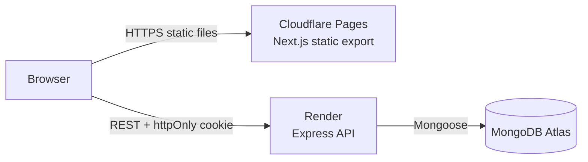

# Doctor Tracker – Backend API

**Elevator pitch:** Doctor Tracker is a secure admin portal for managing doctors and their patients. This repository is the standalone REST API (Node.js, Express, MongoDB) behind it. It handles cookie-based admin authentication, doctor and patient CRUD with fast search, filtering and pagination, and the aggregated analytics that power the dashboard.

## Live links

- **Live app (login page):** https://doctortracker.bizvely.com/admin-login
- Live API health check: https://doctortracker-api.bizvely.com/health
- Frontend repository (screenshots and UI documentation): https://github.com/Bizvely/doctor-tracker-frontend

### Demo login

| | |
|---|---|
| Email | `demo@doctortracker.com` |
| Password | `IHRhgs976#@$` |

> **⏳ Free hosting notice:** this API runs on Render's free plan, which sleeps when idle. The **first request after a quiet period can take up to about 40–50 seconds** (sometimes close to a minute). An UptimeRobot monitor pings `/health` every 5 minutes to reduce this, but the free plan can still sleep or restart, so the wait can still happen. Open `/health` once to wake it up, then use the app normally.

## Tech stack

Node.js 20+, Express 4, TypeScript, MongoDB (Atlas) with Mongoose, Zod (validation), bcryptjs, JSON Web Tokens (httpOnly cookie), Helmet, express-rate-limit.

## Setup guide (local)

1. Install Node.js 20 or newer and create a free MongoDB Atlas cluster (or use a local MongoDB).
2. Install dependencies:
   ```bash
   npm install
   ```
3. Create your environment file from the template and fill in the values:
   ```bash
   cp .env.example .env
   ```
4. Start the dev server (auto-reload):
   ```bash
   npm run dev
   ```
5. Open http://localhost:5000/health. You should see `{"status":"ok","db":"connected",...}`.
6. The first start creates the admin user from `ADMIN_EMAIL` / `ADMIN_PASSWORD` (and the demo user from `DEMO_USER_EMAIL` / `DEMO_USER_PASSWORD`, if set). Run the frontend (see its README) and sign in.

Production build: `npm run build` then `npm start`. Type check only: `npm run typecheck`.

### Environment variables (`.env.example`)

| Variable | Required | Description |
|---|---|---|
| `NODE_ENV` | no | `development` (default) or `production`. In production the auth cookie is `Secure`. |
| `PORT` | no | Port to listen on (default `5000`). |
| `MONGO_URI` | yes | MongoDB connection string, ending with the database name `doctor_tracker`. |
| `CLIENT_ORIGIN` | yes | Allowed frontend origin(s), comma separated. Used for CORS and the CSRF origin check. |
| `JWT_SECRET` | yes | Random secret, at least 32 characters. |
| `COOKIE_SAMESITE` | no | `lax` (default), `strict` or `none`. |
| `ADMIN_NAME`, `ADMIN_EMAIL`, `ADMIN_PASSWORD` | no | If both email and password (min 12 chars) are set, the admin is created on first start when it does not exist yet. Changing them later does not change an existing admin. |
| `DEMO_USER_EMAIL`, `DEMO_USER_PASSWORD` | no | Optional separate account for reviewers (password min 12 chars). Created on start if missing. Its password cannot be changed from the app, so a reviewer can never lock the owner out. |

All variables are validated with Zod at startup. The server refuses to start if something is wrong.

## API reference

All `/api/*` routes except `POST /api/auth/login` require the auth cookie.

| Method | Route | Purpose |
|---|---|---|
| GET | `/health` | Liveness and database status (public) |
| POST | `/api/auth/login` | Sign in, sets httpOnly cookie |
| POST | `/api/auth/logout` | Clears the cookie |
| GET | `/api/auth/me` | Current admin |
| POST | `/api/auth/change-password` | Change password (not allowed for the demo account); older sessions stop working |
| GET | `/api/doctors` | List: `search`, `specialization`, `hospital`, `from`, `to`, `sort`, `page`, `limit` |
| GET | `/api/doctors/meta/options` | Filter dropdown values |
| POST | `/api/doctors` | Create doctor |
| GET / PUT / DELETE | `/api/doctors/:id` | Read, update, delete (blocked while the doctor has patients) |
| GET / POST | `/api/doctors/:id/patients` | List / add patients of one doctor |
| DELETE | `/api/doctors/:id/patients/:patientId` | Remove a patient from that doctor |
| GET | `/api/patients` | List: `search`, `condition`, `doctorId`, `from`, `to`, `sort`, `page`, `limit` |
| GET | `/api/patients/meta/options` | Conditions, genders, doctors for dropdowns |
| POST | `/api/patients` | Create patient |
| GET / PUT / DELETE | `/api/patients/:id` | Read, update, delete |
| GET | `/api/dashboard/stats` | Totals, visits, patients per doctor, daily series, condition split (`range` is 7, 30 or 90 days) |
| GET | `/api/dashboard/demo-status` | Whether sample data is currently loaded |
| POST | `/api/dashboard/demo-data` | Load sample data (only into an empty database) |
| DELETE | `/api/dashboard/demo-data` | Remove only the sample doctors and patients |

Responses use `{ success, data, pagination? }`. Errors use `{ success: false, message }` with proper status codes (400, 401, 403, 404, 409, 429, 500).

## System architecture



Request pipeline inside the API: Helmet headers, CORS allow-list, global rate limit, JSON body limit (10 KB), origin check on state-changing requests, `requireAuth` (verifies the JWT, that the user still exists, and that the password was not changed after the token was issued), Zod validation (`.strict()`, unknown fields rejected), controller, Mongoose, centralised error handler (no stack traces leak).

Code layout: `routes` (wiring), `controllers` (logic), `validators` (Zod), `models` (Mongoose and indexes), `middleware`, `utils`, `config`.

## Data model and indexes

- **Doctor:** name, specialization, hospital, phone, email (unique), `searchTokens`. Indexes: `email` (unique), `name`, `specialization + createdAt`, `hospital + createdAt`, `createdAt`, `searchTokens`.
- **Patient:** name, age, gender, phone, condition (enum), notes, visitDate (date only, stored as UTC midnight), `doctor` (reference), `searchTokens`. Indexes: `doctor + visitDate`, `condition + visitDate`, `visitDate`, `name`, `searchTokens`.
- **User:** name, email (unique), `passwordHash` (never returned by queries), `passwordChangedAt`.

## Technical decisions

### 1. Search with an indexed token list instead of `/text/i` regex

A case-insensitive, unanchored regex such as `/sarah/i` cannot use a B-tree index, so MongoDB scans the whole collection for every keystroke. Instead, each doctor and patient stores a small array of lowercase word tokens (`searchTokens`, accent-folded, Bangla-safe) with a multikey index. A search for `city gen` becomes: every typed term must be the **prefix** of some token (`^city`, `^gen`). Anchored, case-sensitive prefix regexes use tight index bounds. Tokens are rebuilt on create and update, and a startup job backfills older documents.
**Trade-off:** matching starts at word beginnings (`card` finds Cardiology, `son` does not find Johnson). For fuzzy or typo-tolerant search at larger scale, the next step is MongoDB Atlas Search.

### 2. httpOnly cookie sessions with an origin check instead of tokens in localStorage

The JWT lives only in an `httpOnly`, `Secure`, `SameSite=Lax` cookie, so JavaScript (and therefore any XSS) cannot read it. Because cookies are sent automatically, state-changing requests are protected against CSRF by an allow-listed `Origin` check plus `SameSite`. The frontend and API are deployed on the same site (`doctortracker.bizvely.com` and `doctortracker-api.bizvely.com`), which makes `Lax` sufficient.
**Trade-off:** tokens are stateless with a 1-day expiry, so logout only clears the cookie in that browser and there is no server-side revocation list yet. Changing the password does invalidate all older tokens.

## Security summary

bcrypt (cost 12) with a dummy hash to equalise timing for unknown emails; login limited to 10 failed attempts per 15 minutes per IP; password change limited to 5 failed attempts per 15 minutes; general limit 300 requests per 15 minutes; sample-data actions limited to 5 per hour; strict Zod schemas on bodies and query strings; regex input escaped; ObjectId checks on every `:id`; admin and demo accounts are created from environment variables (no password in code); the demo account cannot change its password; the database user has `readWrite` on the `doctor_tracker` database only; `.env` is git-ignored.

## Performance and scalability notes

- List endpoints run the page query and the count in parallel and use `.lean()`. Patients per doctor for a page are computed with one aggregation, not one query per row.
- Dashboard runs five independent queries in parallel with `Promise.all`. Counts use `estimatedDocumentCount`; "patients per doctor" groups and limits first and only then looks up doctor names. Missing days are zero-filled in the API.
- Known limits and next steps: offset pagination becomes slow for very deep pages (move to cursor pagination), dashboard results could be cached for short periods, and the stateless JWT could get refresh tokens and revocation.

## Deployment

Render web service (free plan). Build: `npm install --include=dev && npm run build`, start: `npm start`. Set every variable from the table above in the Render **Environment** tab. A free instance sleeps after inactivity, so the first request can take up to about 40–50 seconds. To reduce this, an UptimeRobot HTTP monitor calls `/health` every 5 minutes; it does not remove the cold start completely. Custom domain via Cloudflare DNS (DNS only). MongoDB Atlas network access is open (`0.0.0.0/0`) because Render's free plan has no fixed outgoing IP, so the database relies on a strong generated password and a least-privilege database user.
